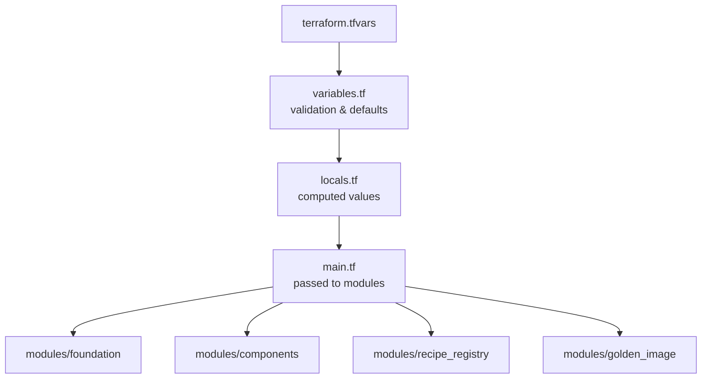
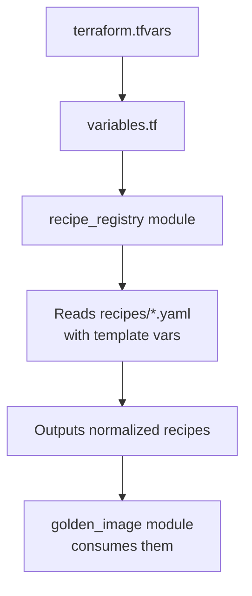

# 📋 Configurable Values Reference - terraform.tfvars

> **Version:** 2.1 | **Last Updated:** 2025-11-09 | **Author:** Platform Engineering

---

## 🎯 Overview

The entire configuration has been refactored so that **`terraform.tfvars` is the single source of truth** for all environment-specific values. All hardcoded values in modules and locals have been replaced with variables that can be overridden in `terraform.tfvars`.

---

## 📁 Files Modified

| File | Changes |
|------|---------|
| 📄 `environments/prod/terraform.tfvars` | **Main Configuration** - Complete rewrite with 50+ values |
| 📄 `environments/prod/variables.tf` | Added 25+ variables with validation & descriptions |
| 📄 `environments/prod/locals.tf` | Updated to derive all values from variables |
| 📄 `environments/prod/main.tf` | Updated to pass all new variables to modules |
| 📄 `modules/recipe_registry/variables.tf` | Added `default_root_volume_size`, `default_lifecycle_policy_count` |
| 📄 `modules/recipe_registry/main.tf` | Updated to use new defaults in template interpolation |
| 📄 `modules/recipe_registry/recipes/*.yaml` (5) | Updated to use `${default_stig_level}`, `${default_root_volume_size}`, `${default_lifecycle_policy_count}` |

---

## 🔧 All Configurable Values

### 🎯 Deployment Targets

| Variable | Type | Default | Description |
|----------|------|---------|-------------|
| `deployments` | `map(object)` | See tfvars | AWS accounts/regions for deployment |
| `deployment_name` | `string` | `"jetstarairwaysnonprod_syd"` | Selected deployment target |

**Example:**
```hcl
deployments = {
  my-prod = {
    account_name = "Production"
    account_id   = "123456789012"
    aws_region   = "us-east-1"
  }
}
deployment_name = "my-prod"
```

---

### 🌐 Network Configuration

| Variable | Type | Required | Description |
|----------|------|:--------:|-------------|
| `vpc_id` | `string` | ✅ Yes | VPC for build instances |
| `subnet_id` | `string` | ✅ Yes | Private subnet for build instances |

> **Requirement:** Subnet must have outbound internet or VPC endpoints for SSM, S3, package repos.

---

### 🏷️ Project Metadata & Tags

| Variable | Type | Default | Description |
|----------|------|---------|-------------|
| `project` | `string` | `"jq-golden-ami"` | Project name prefix |
| `common_tags` | `map(string)` | See below | Common tags for all resources |
| `extra_tags` | `map(string)` | `{}` | Additional tags merged with common_tags |

**Default Common Tags:**
```hcl
common_tags = {
  CostCentre  = "579087"
  CreatedBy   = "DL-TechInfraCloud@singhworld.com"
  Environment = "Production"
  DeployedBy  = "IAC using Terraform"
  Owner       = "DL-TechInfraCloud@singhworld.com"
  ProtectedBy = "Tech-Infra-Cloud@singhworld.com"
}
```

---

### 🖥️ EC2 Infrastructure

| Variable | Type | Default | Description |
|----------|------|---------|-------------|
| `key_pair_name` | `string` | `"MYLABKEY"` | EC2 key pair name |
| `log_bucket_name` | `string` | `""` | S3 bucket for logs (optional) |

---

### 🔐 EBS Encryption

| Variable | Type | Default | Description |
|----------|------|---------|-------------|
| `ebs_encrypted` | `bool` | `false` | Enable EBS/AMI encryption |
| `ebs_kms_key_alias` | `string` | `"alias/aws/ebs"` | KMS key alias for encryption |

> **Note:** Only used when `ebs_encrypted = true`. Use customer managed key (e.g., `alias/ebs-golden`) for cross-account encrypted AMIs.

---

### 🏷️ AMI Naming Convention

| Variable | Type | Default | Description |
|----------|------|---------|-------------|
| `ami_name_prefix` | `string` | `"jq-golden-ami"` | AMI name prefix |
| `ami_architecture` | `string` | `"x86_64"` | Architecture token |
| `ami_date_format` | `string` | `"YYMM"` | Date format (Terraform formatdate pattern) |
| `ami_date_token` | `string` | `null` | Optional date override |
| `ami_release_version` | `string` | `"1"` | Release version suffix |
| `ssm_parameter_prefix` | `string` | `"/golden-ami"` | SSM parameter prefix |

**Resulting AMI Name Pattern:**
```
{ami_name_prefix}-{os_code}-{ami_architecture}-{ami_date_token}.{ami_release_version}-{buildDate}
```

**Example:** `jq-golden-ami-rhel9-x86_64-2501.1-20250115`

---

### 🛡️ Compliance & Hardening

| Variable | Type | Default | Validation | Description |
|----------|------|---------|------------|-------------|
| `stig_level` | `string` | `"high"` | low/medium/high | STIG severity level |

---

### 📋 Recipe Selection

| Variable | Type | Default | Description |
|----------|------|---------|-------------|
| `enabled_recipes` | `list(string)` | All 5 recipes | Recipes to enable from registry |
| `enabled_os` | `list(string)` | `[]` | Legacy OS selection (deprecated) |

**Available Recipes:**
- `rhel-8` - Red Hat Enterprise Linux 8
- `rhel-9` - Red Hat Enterprise Linux 9
- `rhel-10` - Red Hat Enterprise Linux 10
- `windows-2022` - Windows Server 2022
- `windows-2025` - Windows Server 2025

---

### ⚙️ Default Recipe Settings

| Variable | Type | Default | Description |
|----------|------|---------|-------------|
| `default_root_volume_size` | `number` | `100` | Default root volume size (GB) |
| `default_lifecycle_policy_count` | `number` | `3` | Default AMIs to retain per OS |
| `default_stig_level` | `string` | `"high"` | Default STIG level |

> These are used as defaults in recipe YAML files and can be overridden per-recipe.

---

### 🔄 Cross-Account AMI Sharing

| Variable | Type | Default | Description |
|----------|------|---------|-------------|
| `target_account_ids` | `list(string)` | `["774133226694", "373160674113"]` | Target accounts for AMI sharing |

---

### 💻 Instance Types

| Variable | Type | Default | Description |
|----------|------|---------|-------------|
| `windows_instance_types` | `list(string)` | `["t3.large", "t3a.large"]` | Windows instance types (fallback order) |
| `linux_instance_types` | `list(string)` | `["t3.large", "t3a.large"]` | Linux instance types (fallback order) |

---

### ⏰ Pipeline Scheduling

| Variable | Type | Default | Description |
|----------|------|---------|-------------|
| `pipeline_schedule_expression` | `string` | `"cron(0 3 1 * ? *)"` | Image Builder cron expression |
| `schedule_timezone` | `string` | `"Australia/Sydney"` | Schedule timezone |

**Common Cron Expressions:**
```hcl
# Monthly on 1st at 03:00 UTC (default)
"cron(0 3 1 * ? *)"

# Weekly on Monday at 03:00 UTC
"cron(0 3 ? * MON *)"

# Daily at 03:00 UTC
"cron(0 3 * * ? *)"

# Disable (manual/GitHub Actions only)
null
```

---

### 🧪 Test & Lifecycle

| Variable | Type | Default | Description |
|----------|------|---------|-------------|
| `test_timeout_minutes` | `number` | `120` | Test timeout in minutes |
| `images_to_retain` | `number` | `2` | AMIs to retain per pipeline (0 = disable) |

---

### 🔧 Advanced Settings

| Variable | Type | Default | Description |
|----------|------|---------|-------------|
| `linux_root_device_name` | `string` | `"/dev/xvda"` | Linux root device name |
| `windows_root_device_name` | `string` | `"/dev/sda1"` | Windows root device name |
| `install_cloudwatch_agent` | `bool` | `true` | Enable CloudWatch Agent |
| `enable_boot_test` | `bool` | `true` | Enable boot verification test |
| `enable_stig` | `bool` | `true` | Enable STIG hardening |
| `component_version` | `string` | `"1.0.0"` | Component version (managed by content hash) |

---

## 🚀 Usage Examples

### Change Retention to 5 AMIs
```hcl
# In terraform.tfvars
images_to_retain = 5
```

### Enable Encryption with Customer Managed Key
```hcl
# In terraform.tfvars
ebs_encrypted = true
ebs_kms_key_alias = "alias/ebs-golden"
```

### Build Only Specific Recipes
```hcl
# In terraform.tfvars
enabled_recipes = ["rhel-9", "windows-2025"]
```

### Change Schedule to Weekly
```hcl
# In terraform.tfvars
pipeline_schedule_expression = "cron(0 3 ? * MON *)"
```

### Add Custom Tags
```hcl
# In terraform.tfvars
extra_tags = {
  Project     = "Golden-AMI"
  Team        = "Platform"
  CostCenter  = "12345"
}
```

### Override AMI Date Token
```hcl
# In terraform.tfvars
ami_date_token = "2501"  # Forces YYMM to 2501
```

### Use Different Instance Types
```hcl
# In terraform.tfvars
linux_instance_types   = ["m6i.large", "m5.large"]
windows_instance_types = ["m6i.large", "m5.large"]
```

---

## 🏗️ Architecture Notes

### Variable Flow



### Recipe Registry Flow



### Key Benefits

| Benefit | Description |
|---------|-------------|
|  | All config in one file |
|  | New environments = new tfvars only |
|  | All variables validated |
|  | Every variable documented |
|  | Recipe YAML uses templates |
|  | Old variables still work |

---

## 🔄 Migration Notes

If upgrading from a previous version:

1. **Review `terraform.tfvars`** - All your previous hardcoded values should now be in this file
2. **Run `terraform plan`** - Expect some recipe replacements due to:
   - Root device name changes (Linux: `/dev/sda1` → `/dev/xvda`)
   - Volume size changes (Windows 2025: 50GB → 100GB default)
   - These are normal and expected
3. **Apply changes** - The replacements use `create_before_destroy` so pipelines remain available

---

## 📚 Related Documentation

| Document | Description |
|----------|-------------|
| 📄 [SOLUTION.md](SOLUTION.md) | Enterprise solution design |
| 📄 [CLAUDE.md](CLAUDE.md) | Project instructions |
| 📄 [CROSS_ACCOUNT_SHARING.md](CROSS_ACCOUNT_SHARING.md) | Cross-account sharing guide |

---

<div align="center">

**📄 Document Version: 2.1**  
**👤 Author: Platform Engineering**  
**📅 Last Updated: 2025-11-09**

</div>