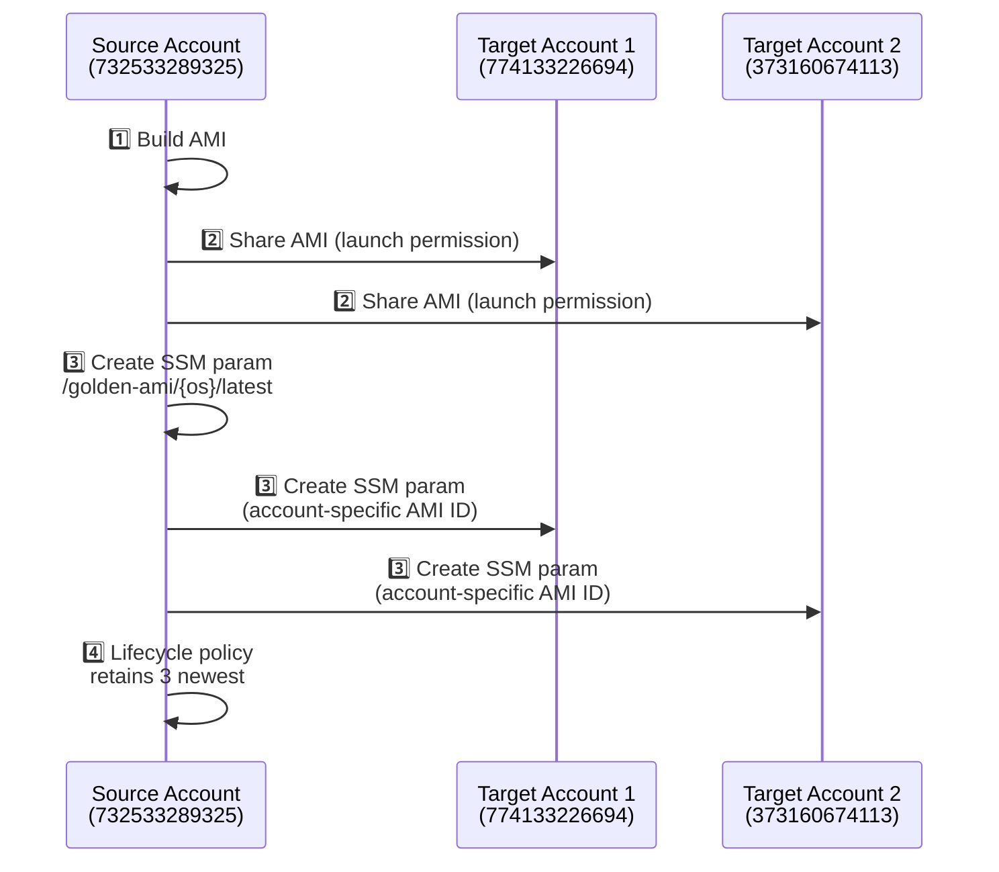
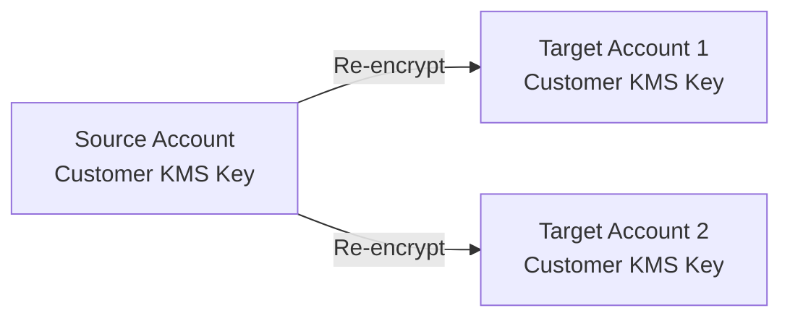

# 🔄 Cross-Account AMI Sharing - Enterprise Guide

> **Version:** 2.2 | **Last Updated:** 2025-11-10 | **Author:** Platform Engineering

---

## 📋 Overview

This project uses **AWS EC2 Image Builder's native cross-account distribution** to automatically share AMIs with target accounts during pipeline execution. No separate Terraform configuration or apply is required beyond the initial setup.

### 🏷️ Current Configuration

| Account | ID | Role | Region |
|---------|-----|------|--------|
| 🟠 **Source** | `732533289325` | Development (Build) | `ap-southeast-2` |
| 🔵 **Target 1** | `774133226694` | Production (Consumer) | `ap-southeast-2` |
| 🟣 **Target 2** | `373160674113` | Management (Consumer) | `ap-southeast-2` |

### 🔐 Encryption Status
> **Current:** Disabled by default (`ebs_encrypted = false`) for seamless sharing  
> **Future:** Customer managed KMS keys when encryption enabled

---

## ⚙️ How It Works

The `golden_image` module's `aws_imagebuilder_distribution_configuration` handles everything automatically:

```hcl
locals {
  # Resolved values for tags (never null/empty to avoid AWS tag validation errors)
  ami_date_token     = var.ami_date_token != null ? var.ami_date_token : formatdate(var.ami_date_format, plantimestamp())
  ami_release_version = var.ami_release_version != "" ? var.ami_release_version : "latest"
}

resource "aws_imagebuilder_distribution_configuration" "this" {
  distribution {
    region = data.aws_region.current.region
    
    ami_distribution_configuration {
      target_account_ids = var.target_account_ids  # <-- Shares AMI with these accounts
      ami_tags = merge(var.tags, {
        Name        = local.ami_name_tag
        OS          = var.os_key
        DateToken   = local.ami_date_token
        Release     = local.ami_release_version
        GoldenImage = var.os_key
      })
    }
    
    # SSM parameter in build account
    ssm_parameter_configuration {
      parameter_name = var.ssm_parameter_name
      data_type      = "aws:ec2:image"
    }
    
    # SSM parameter in EACH target account (automatic!)
    dynamic "ssm_parameter_configuration" {
      for_each = toset(var.target_account_ids)
      content {
        ami_account_id = ssm_parameter_configuration.value
        parameter_name = var.ssm_parameter_name
        data_type      = "aws:ec2:image"
      }
    }
  }
}
```

---

## 🔧 Configuration

Target accounts are configured in **`environments/prod/terraform.tfvars`** (single source of truth):

```hcl
target_account_ids = ["774133226694", "373160674113"]
```

> **Note:** The `variables.tf` file defines the variable with validation, but actual values should be set in `terraform.tfvars`.

---

## ➕ Adding More Accounts

### Option 1: Update `terraform.tfvars` (Recommended for Permanent Additions)

```hcl
# In environments/prod/terraform.tfvars
target_account_ids = ["774133226694", "373160674113", "NEW_ACCOUNT_ID_HERE"]
```

```bash
cd environments/prod
terraform apply
```

The next pipeline execution will automatically share AMIs with the new account.

### Option 2: Override via Command Line (For One-Time or Testing)

```bash
cd environments/prod
terraform apply -var='target_account_ids=["774133226694", "373160674113", "NEW_ACCOUNT_ID"]'
```

### Option 3: Override via Environment Variable (For CI/CD)

```bash
export TF_VAR_target_account_ids='["774133226694", "373160674113", "NEW_ACCOUNT_ID"]'
terraform apply
```

---

## 🔄 What Happens Automatically

When the Image Builder pipeline runs:



| Step | Action | Details |
|------|--------|---------|
| 1️⃣ | **AMI Built** | In source account (ap-southeast-2) |
| 2️⃣ | **AMI Shared** | With all accounts in `target_account_ids` |
| 3️⃣ | **SSM Parameters Created** | In source + each target account |
| 4️⃣ | **Lifecycle Management** | Retains 3 newest in source account |

---

## ✅ Verification

### Check SSM Parameter in Target Account

```bash
# In target account (e.g., 774133226694)
aws ssm get-parameter --name "/golden-ami/rhel-9/latest" --region ap-southeast-2
```

The parameter value will be the AMI ID shared from the source account.

### List Shared AMIs in Target Account

```bash
aws ec2 describe-images \
  --owners 732533289325 \
  --filters "Name=name,Values=jq-golden-ami-*" \
  --region ap-southeast-2
```

### Check Launch Permissions

```bash
aws ec2 describe-image-attribute \
  --image-id ami-xxxxx \
  --attribute launchPermission \
  --region ap-southeast-2
```

---

## 🏗️ Architecture Benefits

| Aspect | Benefit |
|--------|---------|
|  | One `terraform apply` configures everything |
|  | Uses Image Builder's built-in cross-account distribution |
|  | Sharing happens during build - no drift |
|  | Parameters created in all accounts automatically |
|  | Add accounts by updating one variable |
|  | Single Terraform state file |
|  | Image Builder execution role handles permissions |

---

## 🔐 Required Permissions

### Source Account (Automatically Configured)

The Image Builder execution role (created by `foundation` module) needs:

| Permission | Resource | Purpose |
|------------|----------|---------|
| `ec2:ModifyImageAttribute` | AMI | For sharing (launch permissions) |
| `ssm:PutParameter` | Target account SSM | For parameter replication |
| `sts:AssumeRole` | Target account distribution role | Cross-account trust |

> ✅ The `foundation` module **dynamically generates** cross-account assume role permissions based on `var.target_account_ids`. No code changes needed when adding/removing accounts.

### Target Account Prerequisites (Manual - One Time Per Account)

Each target account **must** have this IAM role:

```hcl
# In TARGET ACCOUNT (e.g., 774133226694, 373160674113):
resource "aws_iam_role" "imagebuilder_distribution_cross_account" {
  name = "EC2ImageBuilderDistributionCrossAccountRole"
  
  assume_role_policy = jsonencode({
    Version = "2012-10-17"
    Statement = [{
      Effect    = "Allow"
      Principal = { AWS = "arn:aws:iam::732533289325:root" }
      Action    = "sts:AssumeRole"
      Condition = {
        StringEquals = {
          "sts:ExternalId" = "imagebuilder-distribution"
        }
      }
    }]
  })
}

resource "aws_iam_role_policy_attachment" "distribution" {
  role       = aws_iam_role.imagebuilder_distribution_cross_account.name
  policy_arn = "arn:aws:iam::aws:policy/EC2ImageBuilderDistributionCrossAccountRolePolicy"
}
```

**Required AWS Managed Policy:** `EC2ImageBuilderDistributionCrossAccountRolePolicy`

Provides: `ec2:ModifyImageAttribute`, `ec2:CopyImage`, `ssm:PutParameter` on target account resources.

---

## 🔐 Encryption Considerations

### Current Default (Unencrypted) ✅

| Feature | Status |
|---------|--------|
| Cross-account sharing | Works out of the box |
| KMS configuration | Not required |
| AMI encryption | Unencrypted in all accounts |
| **Production status** | Current configuration |

### Encrypted AMIs (Customer Managed Keys) - Future Enhancement

When `var.ebs_encrypted = true` is needed:



#### Requirements:

1. **Source Account:** Customer managed KMS key (`var.ebs_kms_key_alias`)
2. **Key Policy:** Must allow `imagebuilder.amazonaws.com` and target accounts
3. **Target Accounts:** Image Builder re-encrypts with each target's KMS key
4. **Target KMS:** Each target needs a KMS key accessible by Image Builder

#### Source Key Policy Example:

```json
{
  "Sid": "AllowImageBuilder",
  "Effect": "Allow",
  "Principal": { "Service": "imagebuilder.amazonaws.com" },
  "Action": [
    "kms:Encrypt", "kms:Decrypt", "kms:ReEncrypt*",
    "kms:GenerateDataKey*", "kms:DescribeKey"
  ],
  "Resource": "*"
}
```

```json
{
  "Sid": "AllowTargetAccounts",
  "Effect": "Allow",
  "Principal": { 
    "AWS": ["arn:aws:iam::TARGET_ACCOUNT_1:root", "arn:aws:iam::TARGET_ACCOUNT_2:root"]
  },
  "Action": [
    "kms:Decrypt", "kms:DescribeKey",
    "kms:ReEncrypt*", "kms:GenerateDataKey*"
  ],
  "Resource": "*"
}
```

---

## 📊 Limits & Quotas

| Limit | Default | Notes |
|-------|---------|-------|
| AMI sharing per AMI | 50 accounts | Request increase via AWS Support |
| AMI copy per region | 50 concurrent | Per account limit |
| KMS key policy size | 32 KB | May need multiple statements for many accounts |

---

## 🐛 Troubleshooting

### AMI Not Shared

```bash
# Check launch permissions in target account
aws ec2 describe-image-attribute \
  --image-id ami-xxxxx \
  --attribute launchPermission \
  --region ap-southeast-2
```

### SSM Parameter Missing in Target

```bash
# Verify execution role has ssm:PutParameter in target
aws iam simulate-principal-policy \
  --policy-source-arn <execution-role-arn> \
  --action-names ssm:PutParameter \
  --resource-arns "arn:aws:ssm:ap-southeast-2:TARGET_ACCOUNT:parameter/golden-ami/*"
```

### KMS Access Denied (When Encryption Enabled)

- ✅ Verify source KMS key policy allows target accounts
- ✅ Verify target KMS key allows `imagebuilder.amazonaws.com`
- ✅ Check CloudTrail for `KMS.Decrypt` events

### Target Account Role Missing

Ensure each target account has:
- Role name: `EC2ImageBuilderDistributionCrossAccountRole`
- Trust policy pointing to source account (`732533289325`)
- ExternalId: `imagebuilder-distribution`
- Attached policy: `EC2ImageBuilderDistributionCrossAccountRolePolicy`

### Distribution Tag Null Error (FIXED)

**Error:** `Tag value cannot be null. Use empty string instead.`

**Root Cause:** `ami_date_token` defaulted to `null`, `ami_release_version` defaulted to `""` - passed directly to AMI tags.

**Fix Applied:** Local values now resolve null/empty:
```hcl
ami_date_token     = var.ami_date_token != null ? var.ami_date_token : formatdate(var.ami_date_format, plantimestamp())
ami_release_version = var.ami_release_version != "" ? var.ami_release_version : "latest"
```

**Result:** Tags now always have valid values (`DateToken = "2611"`, `Release = "latest"`).

---

## 🚀 Future Enhancement: `accounts.yaml` (Planned)

For dynamic, GitOps-friendly account management at scale (10+ accounts):

```yaml
# accounts.yaml (planned)
accounts:
  - account_id: "999999999999"
    account_name: "new-workload"
    account_alias: "new-wl"
    regions:
      - ap-southeast-2
    ami_distribution:
      enabled: true
      retention_count: 3
      stig_level: "high"
```

This will replace static `target_account_ids` with a declarative account registry supporting per-account region mapping, retention, and compliance settings.

---

## 📚 Related Documentation

| Document | Description |
|----------|-------------|
| 📄 [SOLUTION.md](SOLUTION.md) | Enterprise solution design |
| 📄 [CLAUDE.md](CLAUDE.md) | Project instructions |
| 📄 [CONFIGURABLE_VALUES.md](CONFIGURABLE_VALUES.md) | All tfvars reference |

---

<div align="center">

**📄 Document Version: 2.2**  
**👤 Author: Platform Engineering**  
**📅 Last Updated: 2025-11-10**

</div>